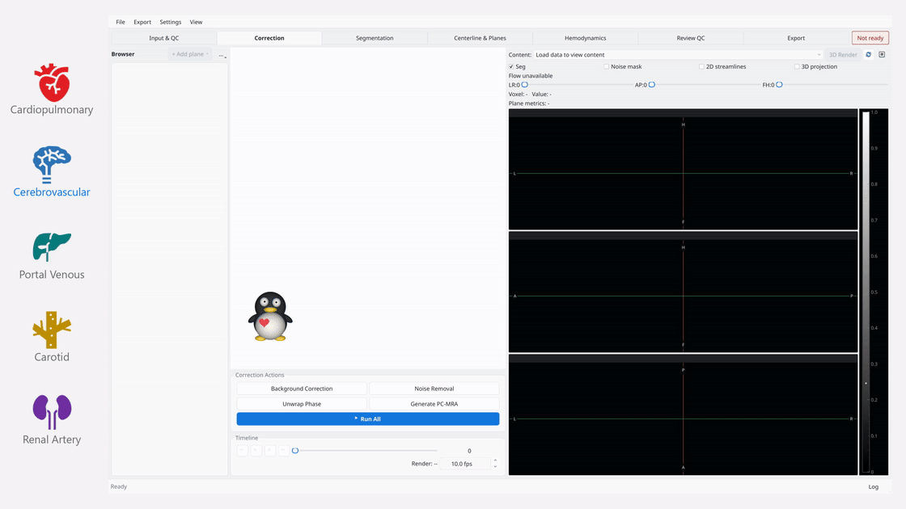

<div align="center">


<h1>AutoFlow</h1>

<p><strong>Automated 4D flow MRI analysis across anatomical regions.</strong></p>

<p>
  <a href="https://github.com/AssociatedPrimeIdeal/AutoFlow/releases"><strong>Windows downloads</strong></a>
  &nbsp;·&nbsp;
  <a href="#quick-start">Quick start</a>
</p>

</div>

<p align="center">
  <a href="autoflow-workflow.mp4?raw=true">
    
  </a>
</p>

AutoFlow brings correction, segmentation, plane metrics, hemodynamics, and quality control into one workflow.
It supports cardiopulmonary, cerebrovascular, carotid, portal venous, and renal artery analysis.
For dual-VENC input, the [reconstruction workflow](docs/en/features/dual-venc.md) keeps loading, HV unwrapping and DV synthesis as separate steps.
PC-MRA [noise removal](docs/en/features/noise-removal.md) defaults to the **Strong** display coherence filter. Right-click **Correction → Noise Removal** to select Medium or turn coherence off. Display filtering preserves acquired data, measurement ROI and quantitative results.

## Quick start

### Windows

CI automatically builds a Windows portable package after Linux and Windows regression tests pass on pushes and pull requests to `main` or `dev`. Download `AutoFlow-windows-x64` from the successful run's **Actions → CI → Artifacts**, extract the complete package to a short ASCII path, and double-click `AutoFlow.exe`. The package uses the current application code and locked Linux segmentation models, without bundled documentation. Builds do not publish application releases.

### Python

With Python 3.11:

```bash
git clone --recurse-submodules https://github.com/AssociatedPrimeIdeal/AutoFlow.git
cd AutoFlow
pip install -e ".[all]"
autoflow-gui
```
