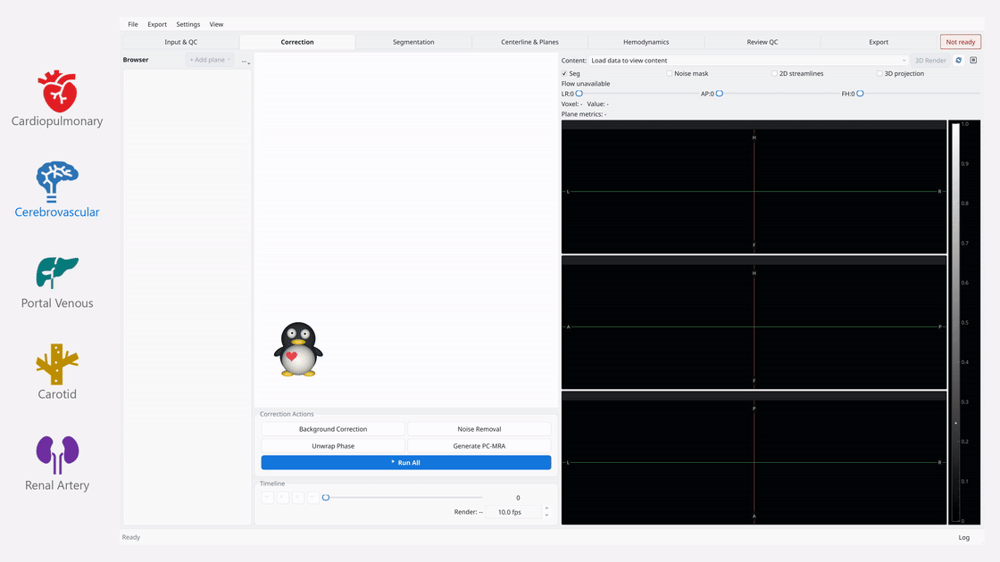

<div align="center">

# AutoFlow

**Automated 4D flow MRI analysis across anatomical regions.**

From correction and segmentation to plane metrics, hemodynamics, and quality control.

[](autoflow-workflow.mp4?raw=true)

</div>

## Install

### Windows

[Download AutoFlow](https://github.com/AssociatedPrimeIdeal/AutoFlow/releases)

### Python

With Python 3.11:

```bash
git clone --recurse-submodules https://github.com/AssociatedPrimeIdeal/AutoFlow.git
cd AutoFlow
pip install -e ".[all]"
autoflow-gui
```
